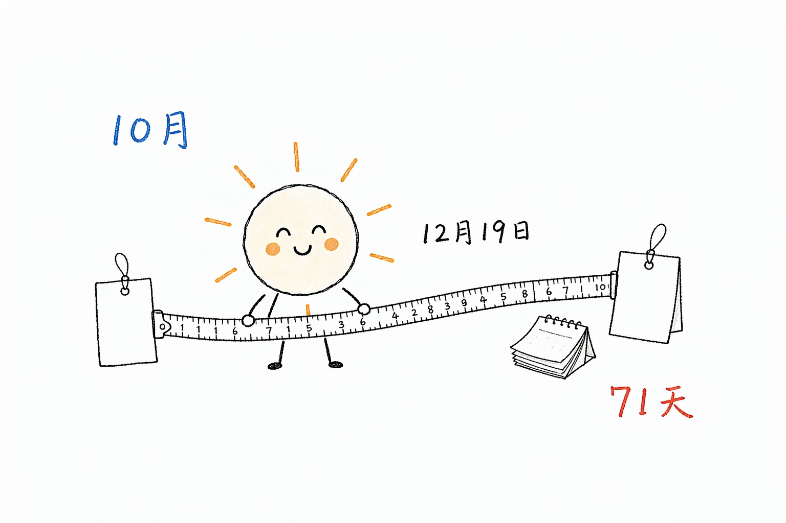

# xiaoan-illustrations

给中文长文配图的技能包（Skill）。读完文章后先出配图策略，再逐张生成「纯白底 + 黑色手绘线稿 + 少量红蓝批注」的怪诞正文配图，视觉 IP 是 **xiaoan**：一个线稿化的太阳头小角色。



## 它做什么

- **先消化正文**：只挑认知锚点配图（核心判断、分流、前后对比、输入输出闭环、常见坑），不平均洒图。默认 4–8 张，长文不超过 9 张。
- **先给 shot list**：每张写清「放在哪个段落后 / 主题 / 核心意思 / 结构类型 / xiaoan 在图里做什么 / 建议标注词」。
- **逐张生成**：一张一条串行出图，不拼图、不并行（并行会让 `output_dir` 互相覆盖、同名文件互删）。
- **生成后自检**：表情是否退化成黑点眼、光芒有没有丢橙色、角色是否被放大压住画面、右下角水印是否清掉。
- **交付**：落到工作区 `assets/<article-slug>-illustrations/`，按 `01-xxx.png` 顺序命名。

## 视觉规则（一句话版）

纯白背景、黑色手绘线稿、大量留白；**橙色只用于 xiaoan 的光芒细线和两点腮红**，**蓝色承载流程**，红色只做少量批注；画面里没有大面积实心饱和色块，物件不许有米色/牛皮纸/灰色填充。xiaoan 必须是画面核心动作的执行者，不是旁边站着的装饰。

## 安装

### 方式 A：git clone（推荐）

按你用的平台选目标路径：

| 平台 | 安装路径 |
| --- | --- |
| WorkBuddy | `~/.workbuddy/skills/xiaoan-illustrations` |
| Claude Code | `~/.claude/skills/xiaoan-illustrations` |
| Codex | `~/.codex/skills/xiaoan-illustrations` |
| 通用（多工具共用） | `~/.agents/skills/xiaoan-illustrations` |

```bash
git clone https://github.com/liulianxz/xiaoan-illustrations.git \
  ~/.workbuddy/skills/xiaoan-illustrations
```

### 方式 B：下载 zip

```bash
curl -L https://github.com/liulianxz/xiaoan-illustrations/archive/refs/heads/main.tar.gz \
  | tar xz -C /tmp
mv /tmp/xiaoan-illustrations-main ~/.workbuddy/skills/xiaoan-illustrations
```

### 依赖（只有两个自检脚本需要）

```bash
python3 -m pip install pillow numpy
```

不装也能用：`scripts/` 只在「去水印」和「视觉重量自检」时被调用，纯生成图不依赖它们。

## 用法

装好后直接说需求即可，典型触发：

- 「给这篇公众号文章配几张 xiaoan 图」
- 「这篇长文哪里适合插图？先给 shot list」
- 「把这张图右下角水印去掉」
- 「这组图角色是不是又变成色块版了，检查一下」

也可以显式调用：`Use $xiaoan-illustrations to 为这篇中文文章设计并生成几张配图。`

## 目录结构

```text
xiaoan-illustrations/
├── SKILL.md                        # 主技能文件（工作流、提示词硬约束、验收标准）
├── references/
│   ├── style-dna.md                # 风格 DNA、颜色分工、禁忌
│   ├── xiaoan-ip.md                # 角色形象、性格、动作库、画法演变
│   ├── composition-patterns.md     # 结构类型、原创隐喻方法、反刻规则
│   ├── prompt-template.md          # 单张生图 / 图生图提示词模板
│   └── qa-checklist.md             # 生成后检查清单与迭代规则
├── scripts/
│   ├── strip_watermark.py          # 去右下角浅色水印（水平外推，不裁剪）
│   └── measure_weight.py           # 实测角色饱和色占比 / 墨迹密度 / 角色框尺寸
├── agents/openai.yaml              # Codex 专用清单（其它平台忽略）
└── assets/
    ├── xiaoan-avatar-reference.jpg # 角色参考图，图生图时传入
    └── examples/                   # 视觉校准图，低频使用
```

## 脚本

```bash
# 去水印（就地覆盖，原图备份到 raw/）
python3 scripts/strip_watermark.py <图片目录> --backup

# 视觉重量自检：线稿版角色饱和橙黄像素应 ≤0.5%，旧色块版约 7%
python3 scripts/measure_weight.py <图片目录>
```

`measure_weight.py` 的判定口径：`≤0.5%` 正常；`0.5–1.0%` 偏重，多半是光芒画粗了；`>1.0%` 基本可判定滑回色块版，重生成。

## 跨平台适配说明

- SKILL.md 里提到的内置 `image_gen`，在 WorkBuddy 中对应 **ImageGen** 工具（文生图 / 图生图均可）。
- **输出尺寸**：图像模型实际产出多为 **1536×1024（3:2）**，不是 16:9。不要为凑比例硬裁，会切掉画面标注文字。
- **角色一致性**：优先图生图并传入 `assets/xiaoan-avatar-reference.jpg`，`input_fidelity` 设 **`low`**。这与常规直觉相反——设 `high` 会把参考图的实心饱和色和高光一起带进来，角色立刻变回「贴纸」。
- `agents/openai.yaml` 只对 Codex 生效，其它平台忽略即可。

## 来源与授权

本技能由 Ian 的 **`ian-xiaohei-illustrations`** 改造而来：保留了原版的视觉系统、工作流与构图规则，角色从「小黑」换代为 **xiaoan**（太阳头 + 黑色细线身体，取自本人公众号头像），并新增了线稿化画法规范、`strip_watermark.py`、`measure_weight.py` 与 WorkBuddy 平台适配注记。

上游项目未声明开源许可证。本仓库中的本地改造部分可自由取用；上游视觉体系与提示词框架的版权归原作者。商用或二次分发前建议先确认上游授权。

---

用起来有问题，提 issue。想改风格，先读 `references/style-dna.md`，改完跑一遍 `scripts/measure_weight.py` 对齐基线。
